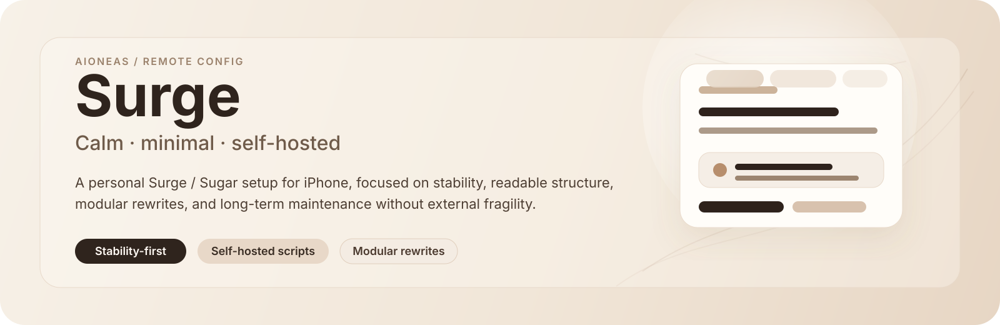

<div align="center">
  
  <h1>Surge</h1>
  <p>面向 Surge iOS 与 Mac 的个人配置、自托管模块与分流规则。</p>
  <p>
    <a href="#quick-start"><strong>快速开始</strong></a>
    ·
    <a href="#modules"><strong>模块安装</strong></a>
    ·
    <a href="#policy-groups"><strong>策略组</strong></a>
    ·
    <a href="#structure"><strong>仓库结构</strong></a>
  </p>
</div>

<a id="quick-start"></a>
## 快速开始

按设备选择公开配置，填入自己的订阅后导入 Surge：

| 设备 | 配置入口 |
| --- | --- |
| iPhone / iPad | [Surge iOS 配置](https://raw.githubusercontent.com/Aioneas/Surge/main/Conf/surge.conf) |
| Mac | [Surge Mac 配置](https://raw.githubusercontent.com/Aioneas/Surge/main/Conf/surge-mac.conf) |

将配置中的 `policy-path=请替换为你自己的Surge订阅地址` 替换为自己的 Surge 订阅链接。模块可独立安装，无需先使用本仓库的主配置。

> [!IMPORTANT]
> 公开配置只保留订阅占位符，不保存节点、证书口令等私人信息。Mac 私人配置如需兼容完整 Surge 订阅，可将订阅中的 `[Proxy]` 节点内联到自己的配置；请勿将含凭据的配置提交到公开仓库。

<a id="modules"></a>
## 模块安装

下方安装链接均为 Surge `.sgmodule`。复制链接，在 Surge 的模块管理中添加远程模块。涉及 HTTPS 内容处理的模块，还需启用 MITM、安装并信任自己的 CA 证书，并开启重写与脚本功能。

### 应用模块

| 模块 | 功能 | 安装 |
| --- | --- | --- |
| [`youtube.aioneas.hide-shorts`](./Module/youtube.aioneas.hide-shorts.sgmodule) | YouTube 去广告、PIP / 后台播放，并尝试隐藏 Shorts | [Install](https://raw.githubusercontent.com/Aioneas/Surge/main/Module/youtube.aioneas.hide-shorts.sgmodule) |
| [`kanlixiang.app`](./Module/kanlixiang.app.sgmodule) | 看理想 App 去广告与推广、VIP 与目录处理、音频及下载链路修正、原生视频播放与页面净化 | [Install](https://raw.githubusercontent.com/Aioneas/Surge/main/Module/kanlixiang.app.sgmodule) |
| [`qqzone.adblock`](./Module/qqzone.adblock.aioneas.sgmodule) | QQ 空间开屏广告及相关广告请求过滤 | [Install](https://raw.githubusercontent.com/Aioneas/Surge/main/Module/qqzone.adblock.aioneas.sgmodule) |
| [`amap.ddgksf2013.full-copy`](./Module/amap.ddgksf2013.full-copy.sgmodule) | 高德地图开屏、信息流及页面推广净化；自托管上游脚本 | [Install](https://raw.githubusercontent.com/Aioneas/Surge/main/Module/amap.ddgksf2013.full-copy.sgmodule) |

> [!TIP]
> YouTube 模块建议置顶安装，可改善后台小窗 / PIP 首次转圈问题。App 更新可能影响模块效果，具体处理范围以模块规则为准。

<details open>
<summary><strong>看理想 App — 功能与安装说明</strong></summary>

看理想仅维护 `kanlixiang.app`，视频兼容已合并，无需额外安装视频补丁或测试模块。

- **广告与推广清理**：处理开屏广告、首页商品与会员推广、弹窗及配置广告字段。
- **VIP、目录与音频处理**：处理 VIP 响应和目录锁态，修正音频及下载链路所需的元数据与播放凭证。
- **原生视频播放**：支持直接播放、播放器内选集切换和进度拖动；非视频请求沿用原处理逻辑。
- **页面净化**：清理会员页购买区域及资料页推广昵称，保留会员权益内容。

安装后启用 MITM、重写与脚本，并信任 Surge CA 证书。模块将 `api.vistopia.com.cn`、`shop.vistopia.com.cn` 追加到 MITM 域名列表。它处理看理想 App，不提供网页版适配。

| 兼容记录 | 版本与环境 | 记录日期 |
| --- | --- | --- |
| 原有功能 | 看理想 v4.14.5；iPhone、iPad 兼容版 | 2026-08-14 |
| 原生视频兼容 | 看理想 v4.17.0；Mac 上的 iOS 兼容版 | 2026-10-27 |

以上是既有测试记录。本次仓库整理没有重新验证设备端播放，也不代表所有 App 版本均兼容；原生视频兼容尚未完成 iPhone / iPad 端复测，下载链路本次亦未复测。

**旧版迁移**：先禁用或移除看理想网页版、融合版及独立视频补丁，再添加上方 App 模块链接，避免重复匹配。旧模块已从当前分支移除，原安装链接停止提供内容，历史版本仍可在 Git 记录中查看。

</details>

<details>
<summary><strong>QQ 空间 — 处理范围</strong></summary>

覆盖广告素材、曝光与点击上报、广告 SDK、部分追踪请求，以及 QQ 空间广告上报接口。域名拦截由规则处理，HTTPS URL 重写需要 MITM 与可信 CA 证书。完整域名和 URL 范围见模块文件。

</details>

### 域名广告过滤

> [!NOTE]
> 以下四个模块按需独立安装，仅提取来源中可映射到 Surge 网络层的域名规则，不包含网页元素隐藏、脚本注入或参数移除等浏览器扩展能力。多个列表可能包含重复域名。

<!-- external-ad-filter-table:start -->

| 模块 | 功能 | 安装 |
| --- | --- | --- |
| [`easylist.sgmodule`](./Module/easylist.sgmodule) | EasyList 域名规则；44,916 条拦截 / 0 条放行 | [Install](https://raw.githubusercontent.com/Aioneas/Surge/main/Module/easylist.sgmodule) |
| [`adguard.mobile-ads.sgmodule`](./Module/adguard.mobile-ads.sgmodule) | AdGuard/uBO – Mobile Ads 域名规则；957 条拦截 / 2 条放行 | [Install](https://raw.githubusercontent.com/Aioneas/Surge/main/Module/adguard.mobile-ads.sgmodule) |
| [`ublock.filters.sgmodule`](./Module/ublock.filters.sgmodule) | uBlock filters – Ads, trackers, and more 域名规则；494 条拦截 / 4 条放行 | [Install](https://raw.githubusercontent.com/Aioneas/Surge/main/Module/ublock.filters.sgmodule) |
| [`easyprivacy.sgmodule`](./Module/easyprivacy.sgmodule) | EasyPrivacy 域名规则；6,933 条拦截 / 4 条放行 | [Install](https://raw.githubusercontent.com/Aioneas/Surge/main/Module/easyprivacy.sgmodule) |

<!-- external-ad-filter-table:end -->

这些模块采用远程 `DOMAIN-SET`，无需 MITM。表格规模随自动更新变化，放行项仅用于排除同一模块的拦截，不强制流量直连。

<details>
<summary><strong>来源与更新方式</strong></summary>

- 模块位于 [`Module/`](./Module)，域名列表与生成清单位于 [`List/`](./List)。
- [`生成脚本`](./tools/build_surge_adlists.py) 提取纯域名规则与可用的放行规则，跳过无法等价表达的过滤语法。
- GitHub Actions 每日生成列表、模块及本节表格，也支持手动触发；模块内不包含浏览器扩展专属能力。

</details>

### 新闻重定向

> [!WARNING]
> `best.viatl.de` 与 `best.998888.best` 为第三方私域付费镜像站，内容非免费。作者仅维护 Surge 客户端适配，非镜像站运营方。

两个模块均覆盖财新、FT 中英文、WSJ、Bloomberg、Economist、NYT 和端传媒。按使用的镜像站**二选一安装**，避免相同文章规则重复匹配。

| 模块 | 功能 | 安装 |
| --- | --- | --- |
| [`news.redirect.aioneas`](./Module/news.redirect.aioneas.sgmodule) | 优选版：文章跳转至 `best.viatl.de`；NYT 匹配非首页路径 | [Install](https://raw.githubusercontent.com/Aioneas/Surge/main/Module/news.redirect.aioneas.sgmodule) |
| [`news.redirect.caixin`](./Module/news.redirect.caixin.sgmodule) | 通用版：文章跳转至 `best.998888.best`，额外覆盖南方周末；NYT 匹配日期型文章路径 | [Install](https://raw.githubusercontent.com/Aioneas/Surge/main/Module/news.redirect.caixin.sgmodule) |

HTTPS 文章跳转需启用重写、MITM 并信任 CA 证书。覆盖范围以模块中的 URL 规则为准。

<a id="policy-groups"></a>
## 策略组

主配置包含服务分流和 `HK`、`US`、`JP`、`TW`、`SG`、`PH` 地区入口。`Proxy Pool` 汇集订阅节点，`Proxies` 提供地区选择，`Final` 负责兜底。

<details>
<summary><strong>查看策略组与默认候选</strong></summary>

| 策略组 | 默认候选 | 说明 |
| --- | --- | --- |
| `Proxy Pool` | 订阅节点 | 隐藏节点池，供地区组筛选 |
| `Proxies` | HK / JP / SG / TW / US / DIRECT | 主节点组，仅展示地区入口 |
| `Final` | Proxies / DIRECT | 兜底 |
| `Google` | Proxies / 地区组 | — |
| `Apple` | Proxies / DIRECT / 地区组 | — |
| `Apple News` | US / Proxies / 地区组 | 默认 US；远端 apple-news.list，Mac 包含 News/newsd 进程规则；apple-news-ads.list 优先拒绝 News 动态广告接口，无需 MITM |
| `X` | Proxies / 地区组 | X / Twitter |
| `Grok` | Proxies / 地区组 | 独立 Grok / xAI |
| `OpenAI` | Proxies / 地区组 | — |
| `Claude` | Proxies / 地区组 | 图标自托管 |
| `DeepSeek` | Proxies / DIRECT / 地区组 | deepseek.com / API / 相关 CDN，图标自托管 |
| `YouTube` | Proxies / 地区组 | — |
| `Netflix` | Proxies / 地区组 | — |
| `Disney` | Proxies / 地区组 | — |
| `HBOMax` | Proxies / 地区组 | — |
| `Bahamut` | Proxies / HK / TW | — |
| `BiliBili` | DIRECT / HK / TW | — |
| `Spotify` | Proxies / DIRECT / 地区组 | — |
| `Steam` | Proxies / DIRECT / 地区组 | — |
| `Telegram` | Proxies / 地区组 | — |
| `Microsoft` | Proxies / DIRECT / 地区组 | — |
| `GitHub` | Proxies / DIRECT / 地区组 | — |
| `PayPal` | Proxies / DIRECT / 地区组 | — |
| `Link` | PayPal / Proxies / DIRECT / 地区组 | Stripe Link，默认跟随 PayPal |
| `WeChat` | DIRECT / HK / Proxies / 地区组 | 默认 DIRECT |
| `WSJ` | HK / Proxies / 地区组 / DIRECT | 默认 HK |
| `Economist` | SG / Proxies / HK / JP / TW / US / DIRECT | 默认 SG |
| `NewYorkTimes` | SG / Proxies / HK / JP / TW / US / DIRECT | 默认 SG |
| `Caixin` | SG / Proxies / HK / JP / TW / US / DIRECT | 默认 SG |
| `Speedtest` | DIRECT / Proxies / 地区组 | — |

</details>

<a id="structure"></a>
## 仓库结构

```text
Surge/
├── Conf/          # Surge iOS / Mac 公开配置，保留订阅占位符
├── Module/        # Surge 模块与远程安装入口
├── List/          # 分流规则、广告域名列表及下游共享规则
├── Script/        # 模块使用的自托管脚本
├── Icon/          # 策略组与模块图标
├── tools/         # 规则生成与维护工具
├── docs/          # 维护与公开仓库安全说明
└── assets/        # 首页视觉资源
```

本仓库专注 Surge 配置与模块。`List/` 中的 `.clash.yaml` 为 `Aioneas/OpenClash` 使用的共享数据，继续保留并由现有工具维护。

维护流程见 [维护说明](./docs/MAINTENANCE.md)，公开内容检查见 [安全说明](./docs/SECURITY.md)。

## 本次整理 · 2026-11-04

- 安装入口统一为 Surge 模块，移除其他客户端适配。
- 移除常规广告过滤、三联中读、数智易正模块及不再使用的专用依赖。
- 看理想合并为单一 App 安装入口，更新原生视频与兼容说明。
- 保留四个独立域名过滤模块，校正新闻重定向覆盖范围并修复图标链接。

## 维护者

**Aioneas**
